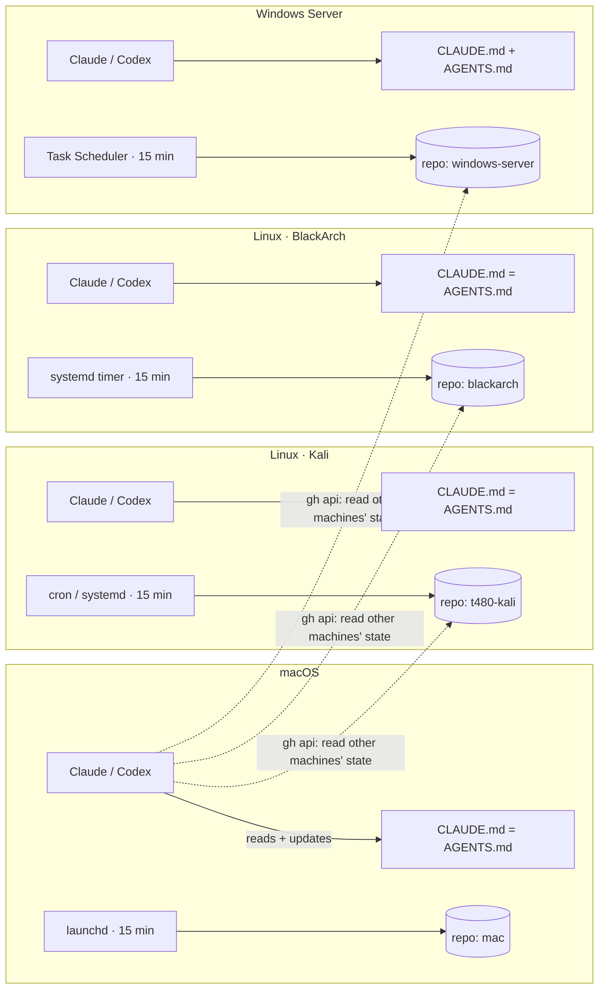

# multi-machine-agent-sync

One shared memory for AI coding agents (Claude Code and Codex) across four machines and three operating systems: macOS, two Linux distributions, and Windows Server. Each machine backs itself up to its own private Git repository every 15 minutes, and every agent reads and updates a single Markdown file that tells it what exists, what has been done, and how to behave.

## The problem

I work with Claude Code and Codex on four machines. Each agent session starts with no knowledge of what another agent did on another machine an hour ago. That produced three recurring failures:

- **Lost work.** Code built in a session lived in whatever folder the agent happened to be in, with no backup.
- **Repeated work.** An agent on one machine re-did setup that an agent on another machine had already finished.
- **Conflicting work.** A single shared repository synced from several machines produced merge conflicts that blocked every machine until someone resolved them by hand.

## The design



**One repository per machine.** Each repository has exactly one primary writer, its own machine, so automatic sync almost never conflicts. Agents on other machines can still read any machine's state through the GitHub API.

**One file, two agents.** Claude Code loads `CLAUDE.md` and Codex loads `AGENTS.md`. On macOS and Linux, `AGENTS.md` is a symlink to `CLAUDE.md`, so both agents edit the same file. Git on Windows does not create symlinks by default, so the Windows sync task keeps the two copies identical instead, and the newer file wins.

**The file is the memory.** Every `CLAUDE.md` begins with the same mandatory rule: pull first, read this file, and record anything you set up, change or decide here, with the date. The sync job then publishes the update. The file also lists every project on the machine and states that new projects go into `~/projects/<name>`, because only that folder is backed up.

**Safe-by-default sync.** Every 15 minutes: commit → `pull --rebase` → push. On a rebase conflict the job aborts the rebase, logs the conflict and pushes nothing, which leaves the working tree intact. Secrets (`.env`, private keys, service-account JSON) are excluded in `.gitignore` before the first commit.

## Repository layout

| Path | What it is |
|---|---|
| [`macos/git_auto.sh`](macos/git_auto.sh) + [`macos/com.git.auto.plist`](macos/com.git.auto.plist) | Sync script and launchd agent (`StartInterval` 900 s, `RunAtLoad`) |
| [`linux/setup.sh`](linux/setup.sh) | Installs the sync script and a systemd user timer (`OnUnitActiveSec=15min`, `Persistent=true`, linger enabled) |
| [`windows/setup.ps1`](windows/setup.ps1) | Installs the sync script and a Task Scheduler job, and keeps `CLAUDE.md` and `AGENTS.md` in step |
| [`templates/CLAUDE.md`](templates/CLAUDE.md) | Starting point for one machine's shared memory file |
| [`templates/.gitignore`](templates/.gitignore) | Secret and noise exclusions applied before the first commit |

## Design decisions

- **Per-machine repositories instead of one monorepo.** Several machines writing to one repository every 15 minutes will eventually edit the same file. Per-machine repositories keep automatic sync safe and still allow reading across machines.
- **Pull before push, even with one writer.** Agents on other machines sometimes edit a machine's `CLAUDE.md` through the API. Without the rebase step, the next automatic push would be rejected.
- **Abort the rebase, never force-push.** An automatic job should never decide how to resolve a conflict. It stops, logs, and leaves the decision to a person or an agent.
- **Adapt per machine and write the reason down.** On one Linux machine the agent found 28 projects that each already had their own Git remote. Mirroring them into one repository would only have stored empty gitlinks. The agent synced a generated `MANIFEST.md` (each project, its remote, its last commit) instead and recorded that deviation in `CLAUDE.md`. The shared file is what makes a deviation like that visible to the next agent.
- **Legacy paths keep working.** Moving existing projects into `~/projects` left symlinks at the old locations, so existing scripts and launchers did not break.

## Setup

Replace `<you>` and `<repo>` with your own values.

**macOS**
```bash
mkdir -p ~/projects && cp macos/git_auto.sh ~/projects/ && chmod +x ~/projects/git_auto.sh
sed "s|__HOME__|$HOME|g" macos/com.git.auto.plist > ~/Library/LaunchAgents/com.git.auto.plist
launchctl load ~/Library/LaunchAgents/com.git.auto.plist
```

**Linux**
```bash
gh auth login && gh repo clone <you>/<repo> ~/projects && bash linux/setup.sh
```

**Windows (PowerShell)**
```powershell
gh auth login; gh repo clone <you>/<repo> $HOME\projects; powershell -ExecutionPolicy Bypass -File windows\setup.ps1
```

## Limits

- Changes on one machine reach its remote within 15 minutes. This is a backup system, not real-time collaboration.
- Agents follow `CLAUDE.md` because it instructs them to, not because anything enforces it. An agent that skips the update leaves a gap in the shared memory.
- Projects that already have their own remote are only as safe as their own push discipline. The manifest approach records them but does not back them up.
